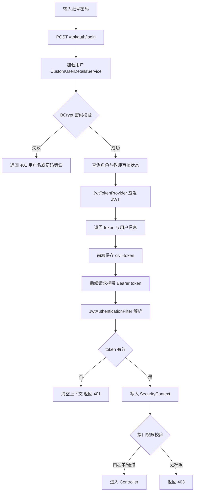
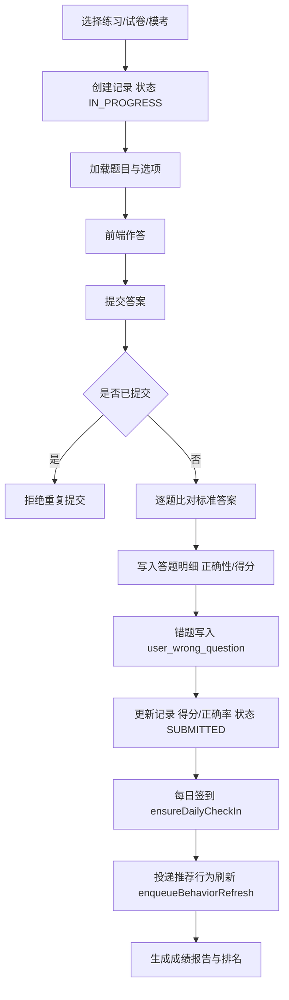
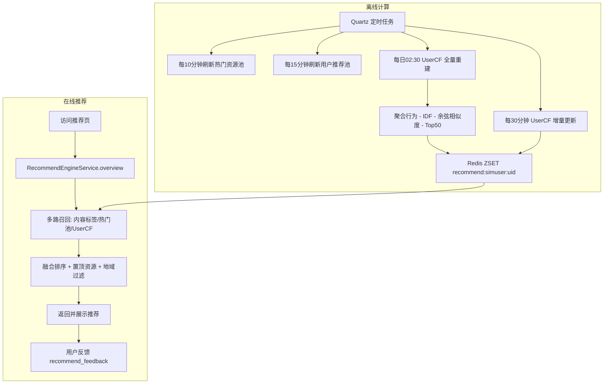

# 公考学习平台（Civil Learning Platform）

[](https://spring.io/projects/spring-boot)
[](https://www.oracle.com/java/)
[](https://vuejs.org/)
[](https://vitejs.dev/)
[](https://www.mysql.com/)
[](https://redis.io/)
[](#免责声明)

> 一个面向公务员考试备考场景的前后端分离学习平台，覆盖课程学习、题库练习、模拟考试、智能推荐、班级教学与后台管理。

## 目录

- [项目简介](#项目简介)
- [功能特性](#功能特性)
- [系统架构](#系统架构)
- [技术栈](#技术栈)
- [目录结构](#目录结构)
- [数据库设计](#数据库设计)
- [核心实现说明](#核心实现说明)
- [接口概览](#接口概览)
- [快速开始](#快速开始)
- [配置说明](#配置说明)
- [默认账号](#默认账号)
- [测试](#测试)
- [部署与安全建议](#部署与安全建议)

## 项目简介

本项目是一个面向公务员考试（行测、申论）备考场景的前后端分离学习平台。系统后端提供统一的业务接口与权限校验，前端分别面向**学员、教师、管理员**三类角色提供操作页面，并额外提供一套移动端（H5）界面。

平台在常规在线学习功能（课程、题库、模考、班级）之外，还实现了几个偏智能化的模块，用于支撑毕业设计的技术深度：

- 基于用户行为的**混合推荐**（内容标签 + 热门资源 + 协同过滤）
- 真实的** UserCF 协同过滤**（余弦相似度 + IDF 热门惩罚 + 倒排索引剪枝）
- 基于 **IRT（项目反应理论）** 的题目难度标定与自适应练习
- 学习**成长体系**：每日任务、知识掌握度、能力画像、成长诊断与预警

本项目主要用于毕业设计与学习演示，非生产级商用系统。

## 功能特性

### 学员端

- 用户注册、登录、JWT 鉴权与个人信息维护
- 课程浏览、课程详情、购买下单、学习播放与学习进度记录
- 题库专项练习、试卷练习、错题本、题目收藏
- 模拟考试、在线答题、自动交卷判分与成绩报告、排名
- 智能推荐页与个性化推荐档案
- 用户中心：学习计划、每日任务、成长档案、能力诊断、知识掌握、测评、导出
- 资讯与公告浏览、收藏分享、按分类订阅
- AI 学习助手（对接 Coze 智能体）与申论 AI 批改

### 教师端

- 教师资格申请与审核状态校验
- 教师工作台、教师公开主页
- 班级创建与管理、邀请码加入班级
- 作业任务、考试任务的布置与题目选择
- 学生提交的作业/考试批改
- 学情报告与班级数据统计

### 管理端

- 运营看板与数据统计
- 用户管理、角色权限管理
- 教师审核、教师管理
- 课程管理、题库管理、考试（试卷）管理
- 资讯管理、公告管理
- 订单管理、退款审核、支付日志
- 推荐配置管理、成长预警管理
- 系统配置、操作日志

### 智能与个性化

- **混合推荐**：内容标签、热门资源、协同过滤多路召回后融合排序
- **UserCF 协同过滤**：余弦相似度 + IDF 热门惩罚，Redis ZSET 在线读取 Top-N 邻居
- **IRT 自适应练习**：题目难度参数标定、按能力选题
- **地域感知推荐**：通过 `X-Exam-Region` 请求头实现按报考地区推荐
- **成长预测与预警**：知识点掌握度、能力画像、成长诊断报告

## 系统架构

系统采用典型的**前后端分离 + 分层单体**架构。

```text
┌─────────────────────────────────────────────────────────────┐
│                         浏览器 / 移动端 H5                      │
│      Vue 3 + Vue Router + Pinia + Element Plus / Vant         │
└───────────────┬───────────────────────────┬─────────────────┘
                │ HTTP (Axios, /api 代理)     │ WebSocket
                ▼                            ▼
┌─────────────────────────────────────────────────────────────┐
│                     Spring Boot 后端 (8080)                    │
│                                                               │
│  Security Filter Chain  →  JwtAuthenticationFilter            │
│           │                                                   │
│           ▼                                                   │
│  Controller 层 (19 个)  ── 统一响应 ApiResponse / PageResult    │
│           │                                                   │
│           ▼                                                   │
│  Service 层 (28 个)     ── 业务编排、算法、事务                  │
│           │                                                   │
│           ▼                                                   │
│  Mapper 层 (MyBatis-Plus, 83 个)                              │
│           │                                                   │
│           ├── MySQL 8    业务数据、76 张表                      │
│           └── Redis      推荐缓存(ZSET)、状态、热点数据          │
│                                                               │
│  Quartz 定时任务  /  WebSocket(广播、班级聊天)  /  文件上传      │
└─────────────────────────────────────────────────────────────┘
```

**请求处理链路**：客户端请求 → `JwtAuthenticationFilter` 解析并校验 Token → Spring Security 鉴权（`@PreAuthorize`）→ `Controller` → `Service` → `Mapper` → MySQL/Redis → 统一封装为 `ApiResponse` 返回。

## 技术栈

### 后端

| 技术 | 版本 | 说明 |
| --- | --- | --- |
| Spring Boot | 2.7.18 | 应用框架 |
| Java | 8+ | 运行环境 |
| Spring Security | 5.7.x | 鉴权与权限控制 |
| MyBatis-Plus | 3.5.5 | ORM / 数据访问 |
| MySQL | 8.0 | 关系型数据库 |
| Redis | 6+ | 缓存 / 推荐在线存储 |
| JJWT | 0.11.5 | JWT 令牌 |
| Quartz | 随 Spring Boot | 定时任务调度 |
| WebSocket | 随 Spring Boot | 消息广播、班级聊天 |
| Springdoc OpenAPI | 1.7.0 | 接口文档（Swagger UI） |
| EasyPoi | 4.4.0 | Excel 导入导出 |
| Lombok | - | 简化实体代码 |
| Maven | 3.6+ | 构建工具 |

### 前端

| 技术 | 版本 | 说明 |
| --- | --- | --- |
| Vue | 3.5.13 | 前端框架 |
| Vue Router | 4.5.0 | 路由管理 |
| Pinia | 3.0.1 | 状态管理 |
| Element Plus | 2.9.8 | PC 端 UI 组件库 |
| Vant | 4.9.24 | 移动端 UI 组件库 |
| ECharts | 5.6.0 | 数据可视化 |
| Axios | 1.8.4 | HTTP 请求 |
| Vite | 6.2.4 | 构建 / 开发服务器 |
| unplugin-auto-import / vue-components | - | 自动导入 |
| Playwright | 1.60.0 | 移动端冒烟测试 |
| Sharp | 0.34.5 | 图片处理（构建脚本） |

## 目录结构

```text
Civil_learning_platform
├── backend/                              # Spring Boot 后端服务
│   ├── src/main/java/com/civil/platform/
│   │   ├── CivilLearningApplication.java # 启动类
│   │   ├── common/                       # 通用能力
│   │   │   ├── annotation/               # @OperationLog 等注解
│   │   │   ├── api/                       # ApiResponse、PageResult 统一响应
│   │   │   ├── aspect/                   # 操作日志 AOP
│   │   │   ├── enums/                    # RoleCode、AuditStatus 等枚举
│   │   │   ├── exception/                # BizException、全局异常处理
│   │   │   ├── util/                     # 工具类（Excel、JSON、题目判分等）
│   │   │   └── web/                      # 分页限制拦截器等 Web 组件
│   │   ├── config/                       # Web、安全、任务、文件、OpenAPI 配置
│   │   ├── security/                     # JWT、登录用户、认证过滤器
│   │   └── module/                       # 业务模块（按功能聚合）
│   │       ├── controller/               # 19 个 REST 控制器
│   │       ├── dto/                      # 请求/响应传输对象
│   │       ├── entity/                   # 数据库实体（84 个）
│   │       ├── mapper/                   # MyBatis-Plus Mapper（83 个）
│   │       ├── service/                  # 业务服务（28 个）
│   │       │   └── recommend/            # UserCF 协同过滤核心
│   │       ├── job/                      # Quartz 定时任务
│   │       └── websocket/                # 全局广播、班级聊天 Handler
│   ├── src/main/resources/
│   │   └── application.yml               # 主配置文件
│   └── pom.xml                           # Maven 依赖与构建配置
├── frontend/                            # Vue 3 + Vite 前端项目
│   ├── src/
│   │   ├── components/                   # 通用组件（头部、AI 助手浮窗、聊天面板等）
│   │   ├── layouts/                      # Public / Admin / UserCenter / Mobile 布局
│   │   ├── pages/                        # 学员、教师、管理员等页面
│   │   │   └── mobile/                    # 移动端页面
│   │   ├── router/                       # 前端路由与守卫
│   │   ├── stores/                       # Pinia 状态（auth、broadcast）
│   │   ├── utils/                        # 请求封装、资源、题目工具
│   │   ├── mobile/                       # 移动端样式与辅助方法
│   │   ├── App.vue
│   │   └── main.js
│   ├── public/                           # 静态资源：课程封面、教师头像等
│   ├── tests/                            # Playwright 移动端冒烟测试
│   ├── vite.config.js                    # 别名、手动分包、代理配置
│   └── package.json                      # 依赖与脚本
├── sql/                                 # 数据库初始化与阶段升级脚本
│   ├── init.sql                          # 全量初始化脚本（76 张表）
│   └── stage-*.sql                       # 分阶段升级脚本（stage-23 ~ stage-47）
├── upload/                              # 本地上传与示例资源
└── .github/                             # 项目辅助配置（如 java-upgrade）
```

## 数据库设计

数据库 `civil_learning` 共 **76 张表**，按业务领域分组如下：

| 领域 | 主要数据表 |
| --- | --- |
| 用户与权限 | `sys_user`、`sys_role`、`sys_user_role`、`teacher_profile` |
| 系统与运维 | `sys_file_record`、`sys_operation_log`、`system_config`、`system_broadcast_message`、`banner`、`notice` |
| 课程 | `course`、`course_chapter`、`course_material`、`course_comment` |
| 资讯 | `news_category`、`news`、`news_comment`、`news_share_log`、`user_news_category_subscription` |
| 班级课堂 | `classroom`、`classroom_member`、`classroom_chat_message`、`classroom_join_request`、`classroom_material`、`classroom_homework(_question/_submission/_answer)`、`classroom_exam_task(_question/_submission/_answer)` |
| 题库与试卷 | `question`、`question_option`、`exam`、`exam_question`、`exam_analysis_course`、`question_irt_stat`、`user_test_paper`、`user_test_paper_question` |
| 学习与练习 | `practice_record`、`practice_answer`、`exam_record`、`exam_answer`、`user_wrong_question`、`user_question_favorite`、`user_course`、`user_course_study_progress`、`user_course_chapter_progress`、`user_course_learning_record` |
| 成长与计划 | `user_study_plan`、`user_daily_task`、`user_daily_checkin`、`user_knowledge_mastery`、`user_knowledge_ability`、`user_ability_profile`、`user_growth_achievement`、`user_growth_diagnosis_report`、`user_growth_assessment_session`、`admin/teacher_growth_focus_follow(_history)`、`admin/teacher_growth_dashboard_preference` |
| 推荐 | `recommend_config`、`recommend_feedback`、`recommend_pinned_resource`、`recommend_refresh_log`、`recommend_practice_bundle` |
| 交易与退款 | `shopping_cart_item`、`course_order`、`course_order_item`、`payment_log`、`course_order_refund`、`course_order_refund_log` |

`sql/` 目录中的 `stage-*.sql` 为按迭代顺序追加的升级脚本（如多题支持、试卷模式、IRT 自适应、UserCF、班级聊天、成长预测字段、性能索引等），可按需增量导入。

## 核心实现说明

### 鉴权与权限

- 无状态会话（`SessionCreationPolicy.STATELESS`），通过 `JwtAuthenticationFilter` 解析 `Authorization: Bearer <token>`。
- Token 由 `JwtTokenProvider` 签发，默认有效期 `86400` 秒。
- 角色分为 `USER`（学员）、`TEACHER`（教师）、`ADMIN`（管理员），方法级鉴权使用 `@PreAuthorize`。
- 公开接口（如登录、首页、课程、资讯、推荐等）在 `SecurityConfig` 白名单中放行，其余接口需要认证。

认证与鉴权整体流程如下：



### 答题与判分流程

练习、试卷与模拟考试共用同一套「开始作答 → 提交判分 → 报告」链路：创建记录后逐题比对标准答案，同步错题本、每日签到与推荐行为。



### 推荐系统

- **混合推荐**（`RecommendEngineService`）：融合内容标签、热门资源池、协同过滤结果，结合用户反馈与置顶资源进行排序。
- **UserCF 协同过滤**（`service/recommend/UserCfService`）：
  - 物品空间统一为 COURSE / EXAM / NEWS；
  - 相似度采用**余弦相似度 + IDF 热门惩罚**，并用**倒排索引**做邻居剪枝；
  - 在线读取 Redis ZSET `recommend:simuser:{uid}`（Top-50 相似用户）；
  - 通过 Quartz 定时任务全量重建（每日 02:30）与增量更新（每 30 分钟）。
- **地域感知**：客户端通过 `X-Exam-Region` 请求头传递报考地区，作为推荐与内容过滤维度。

推荐系统分为在线推荐与离线计算两部分，离线结果为在线召回提供相似用户数据：



### IRT 自适应练习

- `IrtCalibrationService` 基于历史答题记录（`practice_answer`、`exam_answer`）标定题目难度参数，写入 `question_irt_stat`。
- 结合 `user_ability_profile` 与 `user_knowledge_ability`，实现按能力水平选题的自适应练习。
- `IrtCalibrationJob` 负责定时标定。

### 成长体系

- `UserGrowthService` 负责学习计划、每日任务、签到、知识掌握度、能力画像、成长诊断报告与测评会话。
- 支持管理端/教师端的成长关注、看板偏好与历史留痕，用于成长预警。

### 定时任务（Quartz）

| 任务 | Cron | 说明 |
| --- | --- | --- |
| RecommendHotPoolRefreshJob | `0 0/10 * * * ?` | 每 10 分钟刷新热门资源池 |
| RecommendUserPoolRefreshJob | `0 0/15 * * * ?` | 每 15 分钟刷新用户推荐池 |
| UserCfFullRebuildJob | `0 30 2 * * ?` | 每日 02:30 全量重建相似用户 |
| UserCfIncrementalJob | `0 0/30 * * * ?` | 每 30 分钟增量更新相似用户 |
| IrtCalibrationJob | 见实现 | 题目难度参数标定 |

### WebSocket

- `/ws/broadcast`：全局广播消息推送。
- `/ws/classroom-chat`：班级聊天室。

### AI 能力

- **AI 学习助手**（`AiAssistantService`）：对接 Coze 智能体 `v3/chat` 接口，支持会话与结果轮询。
- **申论 AI 批改**（`EssayAiReviewService`）：对接独立的申论批改智能体。
- 两者配置均位于 `application.yml` 的 `app.ai-assistant` 与 `app.essay-grader` 下，**未配置时不影响基础功能**。

## 接口概览

后端接口统一以 `/api` 为前缀，均返回 `ApiResponse` 结构；分页数据使用 `PageResult`。

| 控制器 | 基础路径 | 说明 |
| --- | --- | --- |
| AuthController | `/api/auth` | 登录、注册、当前用户 |
| HomeController | `/api/home` | 首页聚合数据 |
| CourseController | `/api/courses` | 课程浏览、学习、章节 |
| QuestionController | `/api` | 题库、练习、错题、收藏、试卷 |
| ExamCenterController | `/api` | 模拟考试、交卷、报告、排名 |
| RecommendController | `/api/recommend` | 推荐、反馈、推荐档案 |
| ClassroomController | `/api/classrooms` | 班级、成员、邀请码 |
| ClassroomTaskController | `/api/classroom-tasks` | 班级作业与考试任务 |
| TeacherController | `/api/teacher` | 教师工作台、班级、批改 |
| PublicTeacherController | `/api/teachers` | 教师公开信息 |
| UserCenterController | `/api/user-center` | 用户中心（计划、成长、知识等） |
| NewsController | `/api/news` | 资讯 |
| NoticeController | `/api/notices` | 公告 |
| OrderController | `/api` | 购物车、下单、支付、退款 |
| AdminController | `/api/admin` | 后台管理聚合接口 |
| UploadController | `/api/files` | 文件上传与访问 |
| BroadcastController | `/api/broadcasts` | 广播消息 |
| AiAssistantController | `/api/assistant` | AI 学习助手 |
| EssayAiReviewController | `/api` | 申论 AI 批改 |

完整接口文档（Swagger UI）：`http://127.0.0.1:8080/swagger-ui.html`

## 快速开始

### 环境要求

- JDK 8+
- Maven 3.6+
- Node.js 18+
- MySQL 8.0
- Redis 6+

### 1. 初始化数据库

创建数据库：

```sql
CREATE DATABASE civil_learning DEFAULT CHARACTER SET utf8mb4 COLLATE utf8mb4_unicode_ci;
```

导入初始化脚本：

```bash
mysql -uroot -p civil_learning < sql/init.sql
```

如需完整测试数据，可按 `sql/` 目录中阶段脚本的编号顺序继续导入 `stage-*.sql`。

### 2. 启动后端

后端配置文件位于：

```text
backend/src/main/resources/application.yml
```

启动前请根据本机 MySQL 配置修改 `spring.datasource.username` / `spring.datasource.password`。

默认配置：

- 服务端口：`8080`
- MySQL：`127.0.0.1:3306/civil_learning`
- Redis：`127.0.0.1:6379`

启动命令：

```bash
cd backend
mvn spring-boot:run
```

接口文档地址：`http://127.0.0.1:8080/swagger-ui.html`

### 3. 启动前端

```bash
cd frontend
npm install
npm run dev
```

前端默认访问地址：`http://127.0.0.1:3000`

Vite 已将 `/api` 代理到后端 `http://127.0.0.1:8080`。

### 4. 访问移动端

移动端页面位于 `/m` 路径下（如 `http://127.0.0.1:3000/m/home`）。使用移动设备 UA 或窄屏访问根路径 `/` 时，路由守卫会自动跳转到移动首页。移动端与 PC 端之间可相互切换（见 `src/mobile/helpers.js`）。

## 配置说明

`application.yml` 中的关键配置项：

```yaml
server:
  port: 8080

spring:
  datasource:
    url: jdbc:mysql://127.0.0.1:3306/civil_learning?...
    username: root
    password: <YOUR_DB_PASSWORD>
  redis:
    host: 127.0.0.1
    port: 6379

mybatis-plus:
  configuration:
    log-impl: org.apache.ibatis.logging.stdout.StdOutImpl

app:
  jwt:
    secret: <YOUR_JWT_SECRET>
    expire-seconds: 86400
  file:
    base-path: upload
    public-prefix: /api/files/view/
  ai-assistant:            # 可选：AI 学习助手
    api-url: <YOUR_AI_API_URL>
    bot-id: <YOUR_AI_BOT_ID>
    api-key: <YOUR_API_KEY>
  essay-grader:            # 可选：申论 AI 批改
    api-url: <YOUR_AI_API_URL>
    bot-id: <YOUR_AI_BOT_ID>
    api-key: <YOUR_API_KEY>
```

> **安全提示**：请勿将真实的数据库密码、JWT 密钥和 AI 平台 API Key 提交到公开仓库，建议改为从环境变量注入，并为部署环境使用独立密钥。若密钥曾经提交或泄露，请及时在对应平台轮换。

## 默认账号

系统初始化脚本内置以下示例账号（密码均为 `123456`）：

| 角色 | 用户名 | 密码 |
| --- | --- | --- |
| 管理员 | `admin` | `123456` |
| 教师 | `teacher1` | `123456` |
| 学员 | `student1` | `123456` |

> 上述账号仅供本地演示使用，正式环境请务必修改或删除。

## 测试

前端内置 Playwright 移动端冒烟测试：

```bash
cd frontend
npm run test:mobile
```

构建产物体积报告：

```bash
cd frontend
npm run build:report
```

## 部署与安全建议

- 后端打包：`cd backend && mvn clean package`，产物为可执行 Jar，使用 `java -jar` 运行。
- 前端打包：`cd frontend && npm run build`，产物在 `frontend/dist/`，交由 Nginx 等静态服务器托管，并将 `/api` 反向代理到后端。
- 必须修改的配置：数据库账号密码、`app.jwt.secret`、AI 相关 `api-key`。
- 生产环境建议：使用 HTTPS、收紧 CORS 与 WebSocket 允许来源、关闭 MyBatis SQL 控制台日志、为 Redis 设置密码。
- 上传目录 `upload/` 需保证运行用户具有读写权限。

